# ParaWorld Toolkit

Community tools for **ParaWorld** (SEK / Sunflowers, 2006):

* **Model & Map Exporter** – every unit, building, animal and map of the game in 3D, with animations, add-ons and
  player colours; export to GLB, glTF, OBJ, Collada, STL, PLY (FBX, .blend, USD and Alembic with Blender), maps to 3D
  files, height maps and raw data with [Kaitai Struct](https://kaitai.io) descriptions of the map format.
* **ParaWorld Remake** – the game rebuilt for the web browser: the campaign and skirmishes of up to eight players
  with all four tribes on the original maps or random maps, with the rules, models, sounds and interface of your
  installation.
* **Workshop** – new units, buildings, wild animals and decorations: a model made with the Blender add-on (or one of
  the game's, to change), turned into a mod step by step – ParaWorld loads it, the remake plays it.
* **ParaWorld Shooter** – a third-person action game made from the same data: the SEAS Gunner and the Executioner
  MKII against swarms of Dustriders in the Holy City – alone, or as part of a full SEAS assault – and against the
  Norsemen on an island of the game's own making, with a war mammoth to ride and a gunship to fly, and against the
  Dragon Clan on a second one.

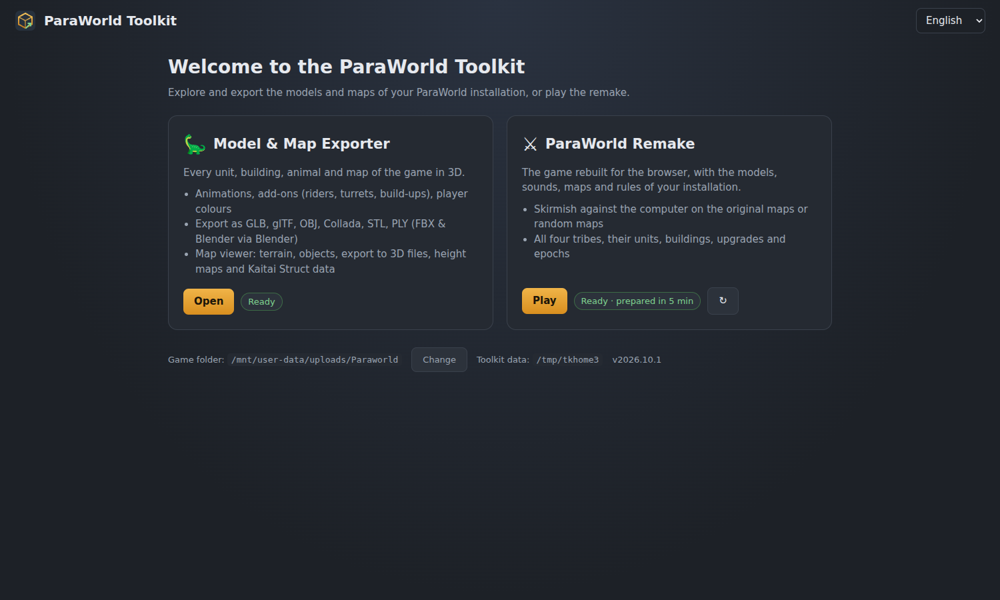

**No game files are included.** You need your own copy of ParaWorld installed: the toolkit asks where it is and
reads everything from there – the exporter on the fly, the remake once on its first start (it converts what it needs
into the toolkit's own data folder). Nothing is uploaded anywhere: the toolkit is a small local web server that only
listens on your computer.

---

## Quick start

1. Install **Python 3.8 or newer** from <https://www.python.org/downloads/> (free). On Windows tick
   **"Add python.exe to PATH"** in the installer.
2. Download the toolkit (*Code → Download ZIP* on GitHub, or `git clone`) and unpack it anywhere.
3. Start it:
   * Windows: double-click **`Start ParaWorld Toolkit.bat`**
   * Linux / macOS: run `./start.sh` in a terminal

   The first start installs two small helper packages (`numpy` and `pillow`) – this needs an internet connection
   once. The launcher then opens in your web browser. Keep the console window open while you use the toolkit; close
   it to quit.
4. Tell the launcher where ParaWorld is installed (the folder that contains `Data`). Found installations are
   offered; **Browse…** opens a folder dialog.
5. Pick a tool:
   * **Model & Map Exporter → Open**. The very first start reads the model archives' tables of contents (10–30 s).
   * **ParaWorld Remake → Prepare the game data** (first time only, about 5–15 minutes: it converts the models,
     textures, interface and rules of your installation), then **Play**.
   * **Workshop → Open** to make new objects ([docs/WORKSHOP.md](docs/WORKSHOP.md)).

Settings, caches and the remake's game data are kept in `%APPDATA%\ParaWorldToolkit` (Linux/macOS:
`~/.config/paraworld-toolkit`). The caches and the game data take several GB (about 2 GB per configuration, plus the
films): **Toolkit data → Change** at the bottom of the launcher moves them to another folder, e.g. onto the drive
ParaWorld is on; the settings stay where they are. The environment variable `PWTOOLKIT_DATA` sets that folder too,
`PWTOOLKIT_HOME` moves everything (settings included).
`python -m toolkit --port 8420 --no-browser` starts the server without opening a browser.

## Model & Map Exporter

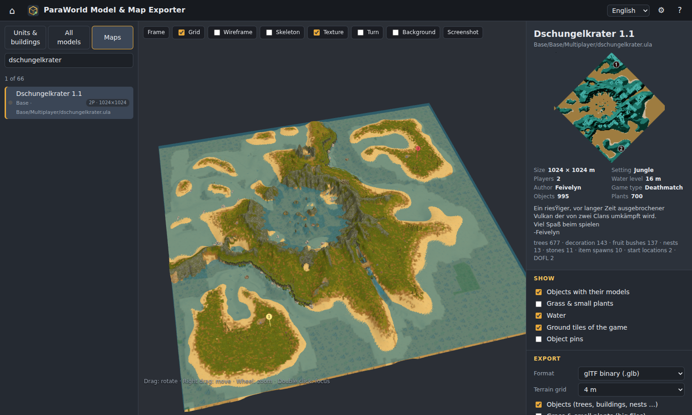

* Explorer for every unit, animal, vehicle, ship, hero and building of the four tribes and the wildlife (search in
  English, German and every language your game has), plus all ~4000 models of every archive.
* Add-ons as the game scripts assemble them: riders and gunners, turrets, build-ups, drawbars and wagons, level flags,
  weapons per level, worker tools, carried goods. Visibility: the in-game look as presets (saddles, armour,
  wounds, construction and damage stages, epochs, night lights) and the 32 raw flag bits of the meshes as a filter;
  player colour. Mods: the base game by default, or any installed mod loaded the way the game loads it (`Data/Info`);
  the copy of a single model from any other mod. Every animation, add-on animations included.
* Maps: terrain with the setting's ground materials, the sea, every placed object with its model; export as 3D file,
  height map, material map, object list (CSV), JSON, preview picture, unpacked map data plus Kaitai Struct
  descriptions (`pwexport/data/ksy/paraworld_ula.ksy`, `paraworld_surf.ksy`).
* Command line for scripts and batch exports (`python -m pwexport.cli`, `python -m pwexport.ula`).
* **HD models** (a proof of concept, for now the shooter's Gunner, Executioner MKII and gun turret): finer meshes and
  4x textures (Real-ESRGAN, no PyTorch needed), and a version rebuilt in Blender - made on your computer with
  `python -m pwexport.hd`, shown by the viewer and the shooter next to the originals: [docs/HD_MODELS.md](docs/HD_MODELS.md).

The full guide with a tutorial: **[docs/EXPORTER.md](docs/EXPORTER.md)**.

## ParaWorld Remake

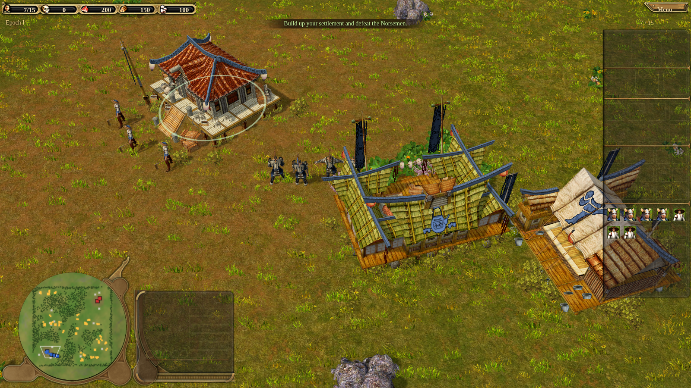

A browser remake built from the original game's data: the original tech tree (BoosterPack 1) evaluated at runtime,
the original server scripts' rules (special moves, auras, the army pyramid, epochs, walls, harbours and fleets,
nests), the computer opponent for every tribe, the original maps, sounds, music, menus and interface art.

* Start a skirmish from the title screen as in the original's setup: up to eight players (you and computer players
  with their tribe, personality, level 0–9, team, colour, handicap and start position), Deathmatch, Domination or
  Defender, a random jungle map or one of the maps of your installation (maps you install into the game appear by
  themselves), and the army budget: buy your start army and resources on the "My Army" page with the game's points.
* In the game: the diplomacy window (your opinion of every player, tribute), the chat (`Enter`; "AI2: help" asks a
  computer player), and at the end the game's statistics with their time line.
* **Debug mode** (skirmish option): everything is free and instant for you, building requirements included.
* Controls follow the original (its key table): left click selects, right click orders (dragged: a formation arrow),
  `Q A Y` / `E D C` / `X` then `1–0` press the command bar's buttons, `V` attack, `B` move, `H` headquarters,
  `Ctrl+0–9` groups, the mouse wheel zooms, `Esc` opens the menu; the whole list is under Controls in the menu.
* The interface is laid out like the original's: the army pyramid on the left, the info window and command bar at the
  bottom left, the minimap as the original draws it (a diamond in the setting's relief colours, fog of war, ping and
  zoom buttons) in the bottom right corner with the tooltip window above it - the tooltips with the original's own
  texts ([remake/docs/MINIMAP.md](remake/docs/MINIMAP.md), [remake/docs/TOOLTIPS.md](remake/docs/TOOLTIPS.md)).

**Computer player.** The opponent is a port of the original's script AI (behaviours, attack plans per epoch,
difficulty handicaps, defence): [remake/docs/COMPUTER_PLAYER.md](remake/docs/COMPUTER_PLAYER.md).

**Campaign.** The original single player missions are read from the installation and run by a trigger engine
written after the original scripts. All 17 missions play to the end, each with any of the four tribes (the player's
buildings and units become the chosen tribe's), with the official game or a mod (MIRAGE ...). The story films are
converted for the browser in the background the first time the campaign menu opens (ffmpeg: the one on the PATH,
else the pip package `imageio-ffmpeg`, installed automatically); until then a film's lines are shown as subtitles.
Missions with an army budget open the army screen first: the mission's own army, and what the bonus points of the
mission before buy on top of it. See
[remake/docs/CAMPAIGN_RUNTIME.md](remake/docs/CAMPAIGN_RUNTIME.md) §13 and [docs/CAMPAIGN_FORMAT.md](docs/CAMPAIGN_FORMAT.md).

**Saved games.** Campaign missions, skirmishes and the sequel can be saved and loaded from the menu: slots in the
browser, or a `.pwsave` file to keep or move; `F5` quick save, `F8` quick load.

**Debug options.** Before any game, *Debug options…* changes its rules: start resources, start and highest epoch,
more places per level of the army pyramid, the unit limit, damage and defence of both sides, the whole map visible,
the mission's bans lifted; in the game the pause menu's *Debug tools* put objects down, give resources, end a mission.
[remake/docs/DEBUG_OPTIONS.md](remake/docs/DEBUG_OPTIONS.md).

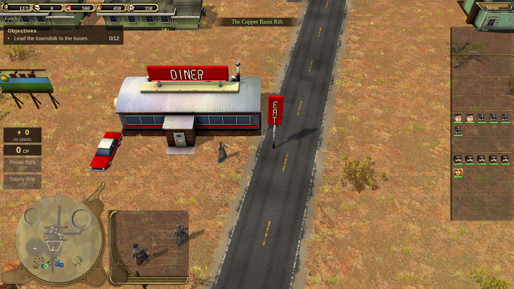

**ParaWorld: Containment (1964).** A new campaign of eleven missions written for the remake, a sequel to the original's
ending: the rifts have opened into our world, and SEAS has to contain the outbreak across 1960s America (once in
London - the city of the original's opening film, rebuilt - and once in ParaWorld). Its own mechanics: rifts sealed by stabilizers, townsfolk to evacuate, tranquilizers and capture trucks,
electrified nets, night and searchlights, command powers, and electricity - a fifth resource made in power plants
and carried home over pole lines the dinosaurs can cut. The 1960s towns, cars and machines are made in Blender from
CC0 materials and painted in ParaWorld's weathered look (remake/art/sequel).
[remake/docs/SEQUEL.md](remake/docs/SEQUEL.md).

All of the remake's documents: [remake/docs/README.md](remake/docs/README.md). How it is built: [remake/docs/ARCHITECTURE.md](remake/docs/ARCHITECTURE.md),
[DATA_PIPELINE.md](remake/docs/DATA_PIPELINE.md), [GAMEPLAY_RULES.md](remake/docs/GAMEPLAY_RULES.md),
[MODDING.md](remake/docs/MODDING.md) and the rules extracted from the original scripts in
[remake/docs/spec](remake/docs/spec).

## Workshop

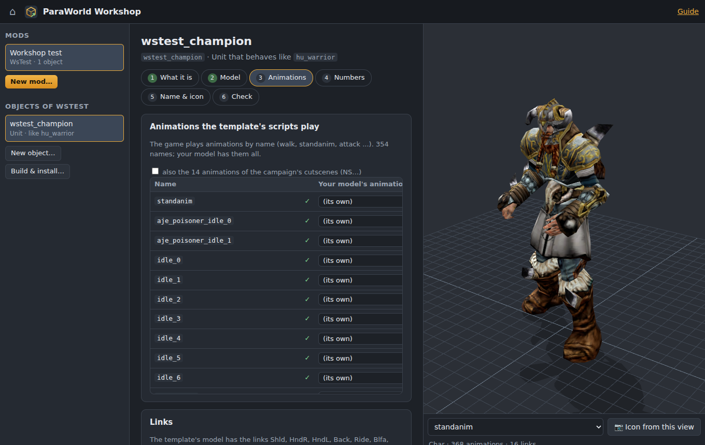

New objects for ParaWorld, made without touching the game's files by hand:

* **Units, buildings, wild animals, decorations.** Each new object behaves like an object of the game you choose (its
  *template*: a Norsemen warrior, a Dustrider barracks, a stegosaurus, a rock) and gets its own model, name, numbers,
  texts and icon.
* **Your model or the game's.** Upload a `.gsf` archive from the ParaWorld GSF add-on for Blender (in `blender/`), or
  take a model of the game – also to download it and change it in Blender. The 3D view shows it with its animations;
  the Workshop matches its animations to the ones the template's scripts play.
* **One mod for both.** The Workshop writes a mod as the game expects it (`Data/<mod>`, `Data/Info/<mod>.info`: the
  tech tree, class lists, model archive, texts, icons, textures), installs it into your game and starts ParaWorld
  with it. The remake offers the installed mod as game data; *Try it in the remake* opens a game with your objects.

The guide, step by step: **[docs/WORKSHOP.md](docs/WORKSHOP.md)** (also behind *Guide* in the Workshop).

## ParaWorld Shooter

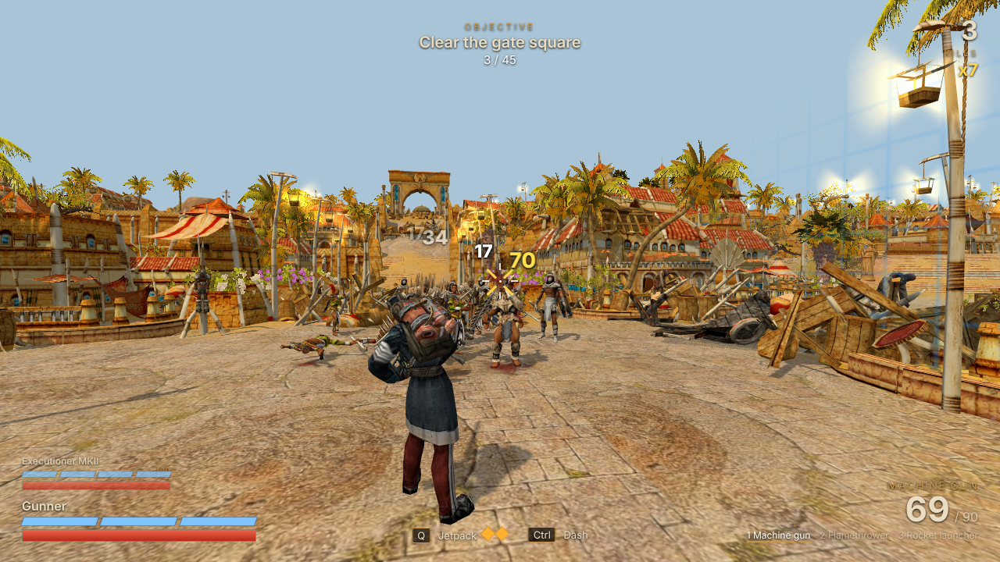

A fast third-person (or first-person) swarm shooter with the models, animations, maps and sounds of your
installation. Four missions:

* **The Holy City** (campaign mission 5): alone through the ruined city, district by district – 17 objectives.
* **The Assault** (the fan-made map *Holy City defender* of the MIRAGE mod; greyed out without it): the SEAS land
  on the north shore and storm the city. Waves of friendly troops fight beside you, the Dustriders' towers shoot
  back, 25 objectives from the beachhead to the temple.
* **Iron Winter**: a map the game builds itself (no map file needed) and a new enemy, the Norsemen. From the
  landing beach through a palisade and a village, up a pass into the snow, across a frozen lake to the fortress of
  the rune gate – 18 objectives. For one of them you ride a **war mammoth** (tusks, stamp, charge: the only thing
  that breaks the stone gate of the pass), for another you fly a **SEAS gunship** over the fortress.
* **Dragon Fire**: the second map of the game's own making and the fourth enemy, the Dragon Clan - smoke towers,
  rocket towers, mine fields, gatlings and flame trikes; from the beach through the rice terraces, the bamboo forest,
  the town and the harbour up the volcano to the temple court and the Seismosaurus titan - 22 objectives.

* Two characters, swapped at any time with `Tab`: the **Gunner** (machine gun, flamethrower, rocket launcher, knife)
  and the **Executioner MKII** (claw combo on the left mouse button, minigun while the right one is held, a ramming
  dash). Both have jetpacks; the Gunner can call a bombardment down around him once a minute (`G`).
* Objectives of five kinds (reach, kill, hold, destroy, boss): burn the war camp, sink the fleet in the harbour,
  bring down the war towers, hold the terrace, hunt down the Stegosaurus and Allosaurus riders, and at the end the
  T-Rex titan.
* Districts that are not open yet are shut off by rubble and a faint energy wall; the rubble is blown away when the
  next objective opens them.
* Armour, executions that restore it, damage numbers, three difficulties, a session log for crash reports.
* HD models (a proof of concept): with HD versions of the Gunner, the Executioner MKII and the gun turret made
  (`python -m pwexport.hd`, [docs/HD_MODELS.md](docs/HD_MODELS.md)) the settings offer "Models": Original / HD / HD
  remodelled.

| | |
|---|---|
| 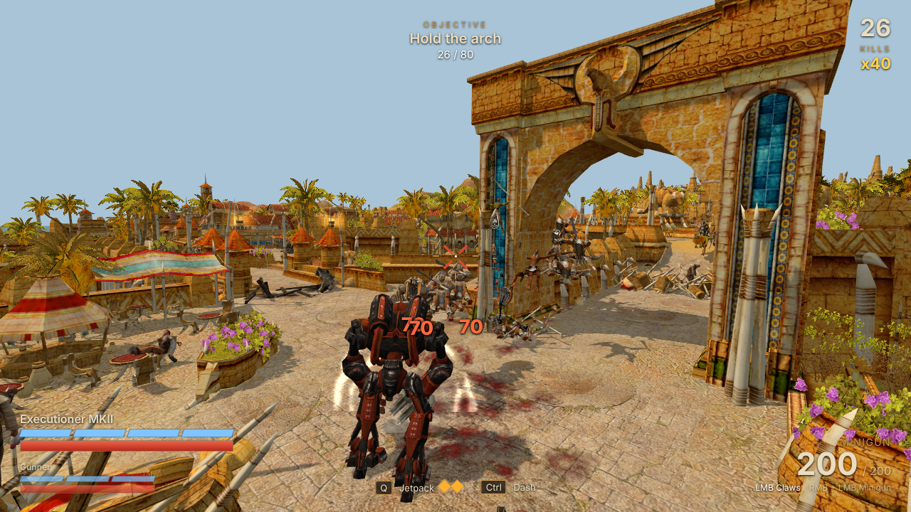 | 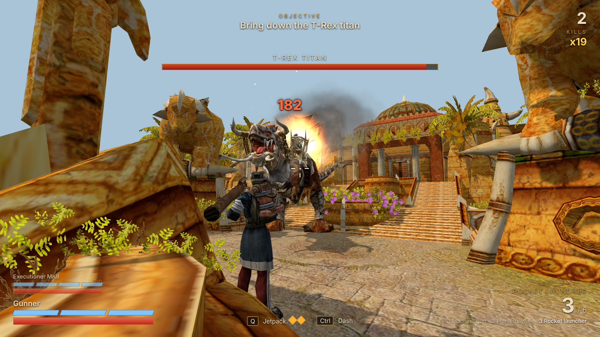 |
| 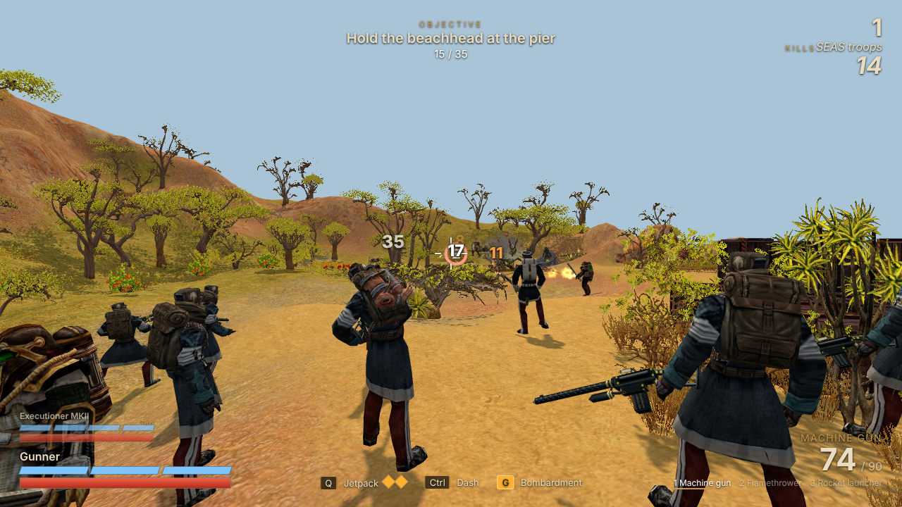 | 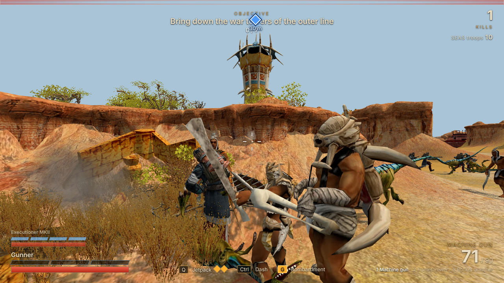 |
| 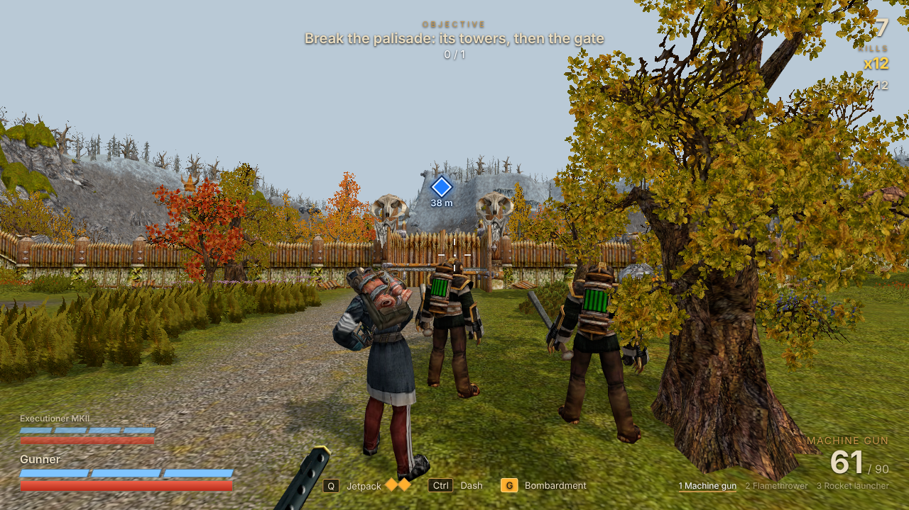 | 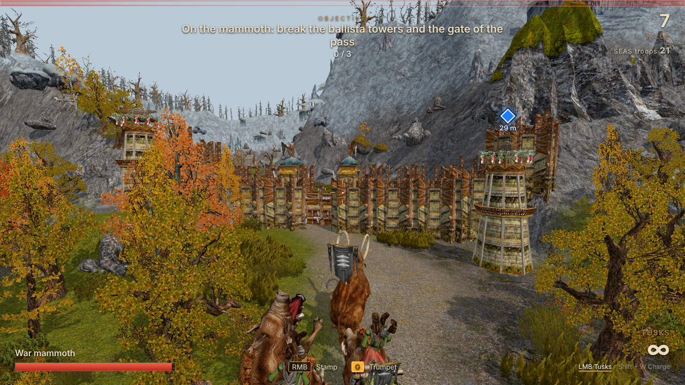 |
| 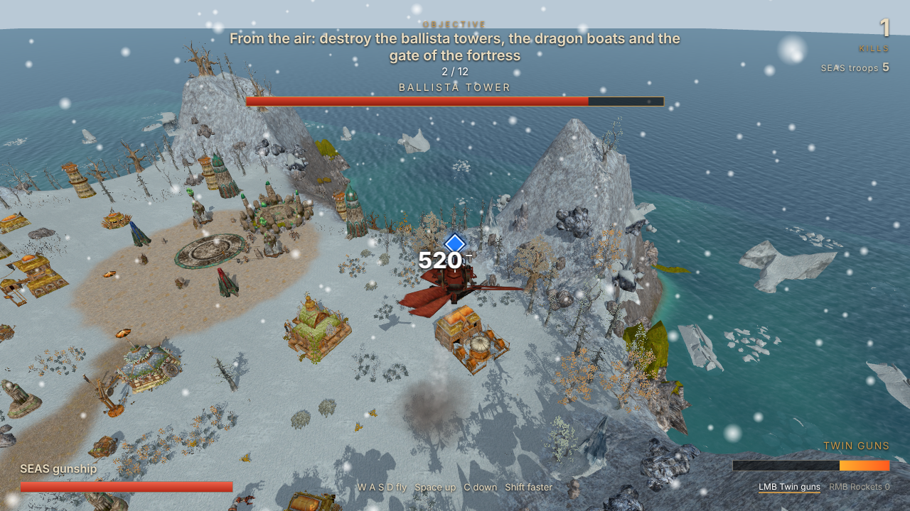 | 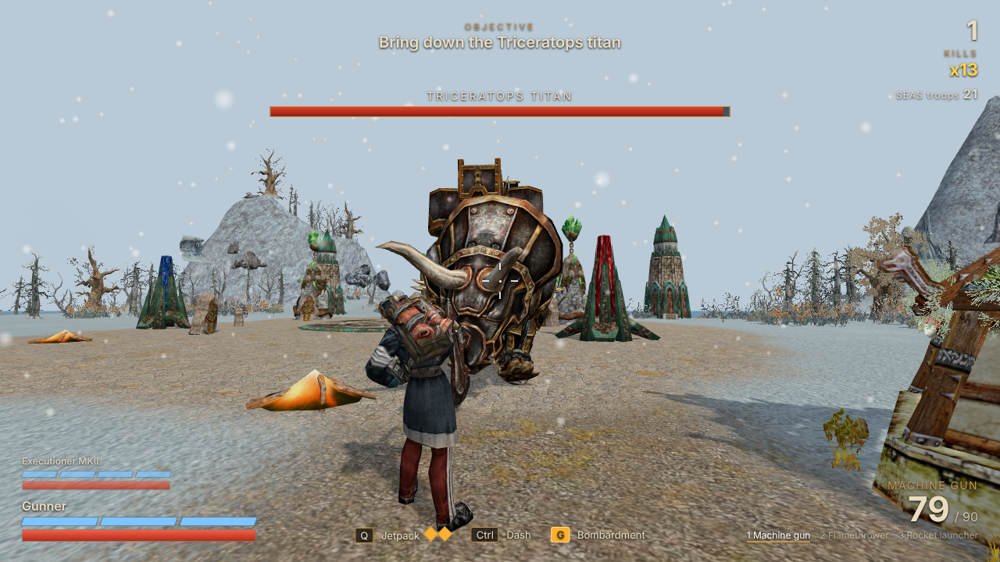 |
| 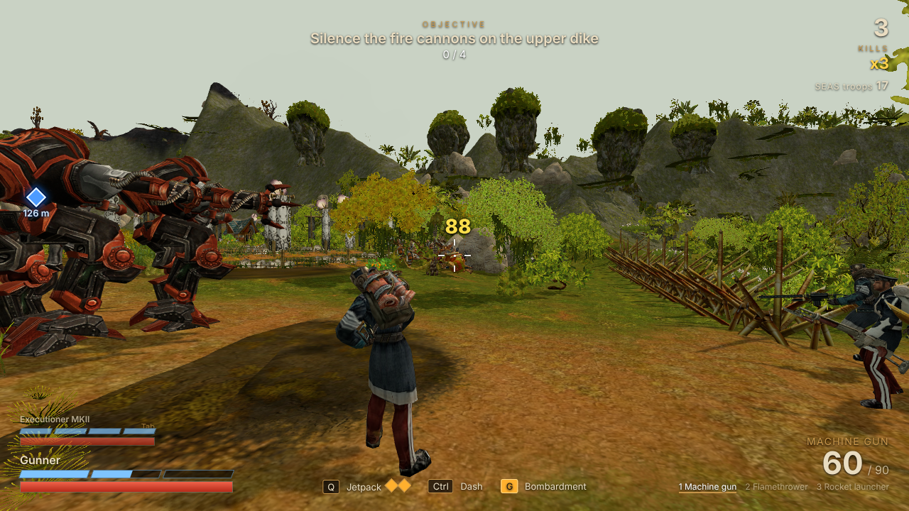 | 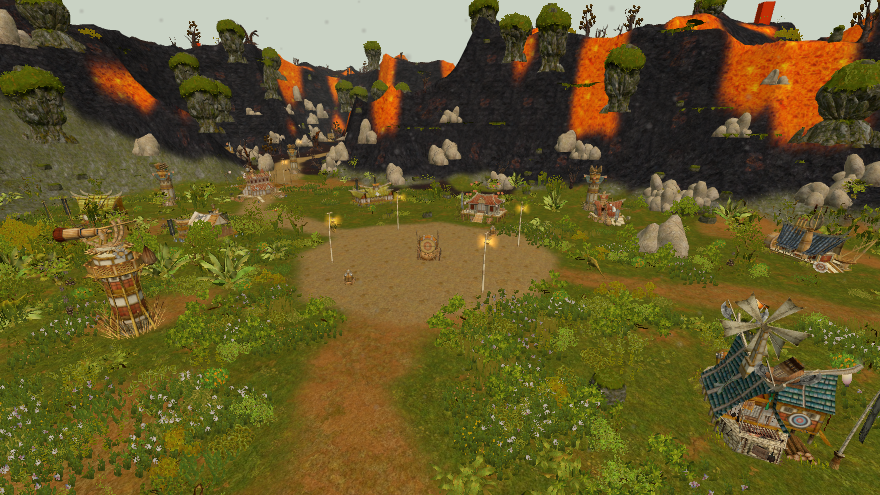 |
| 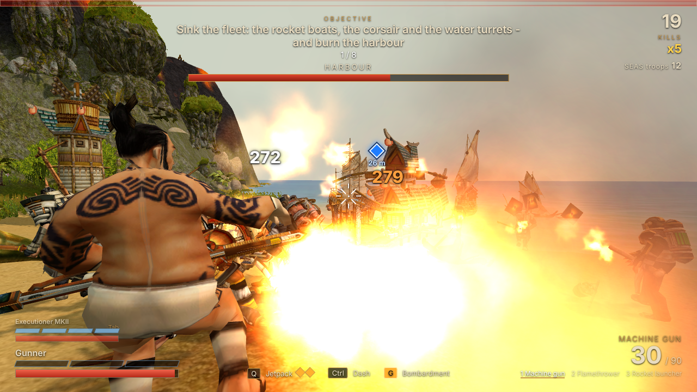 | 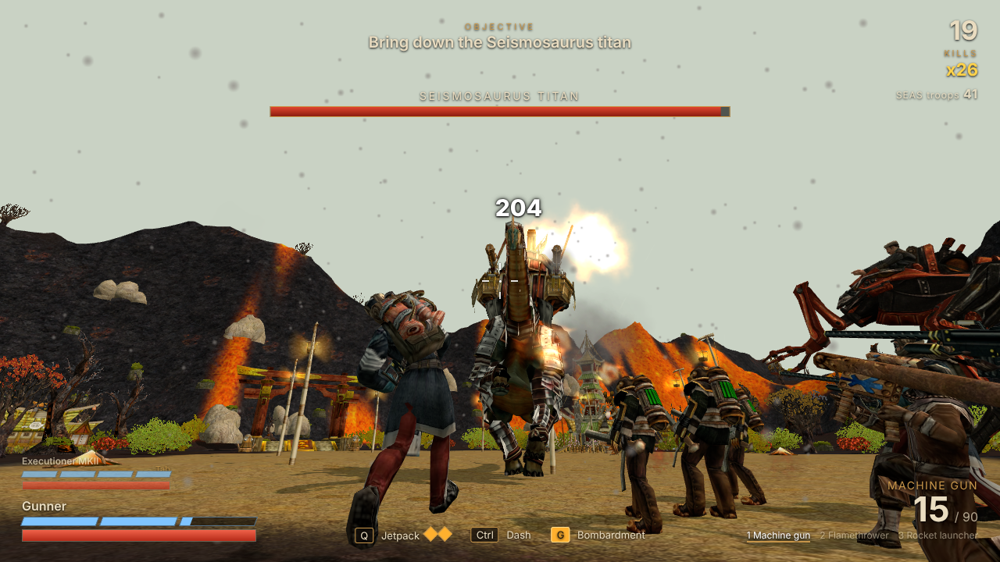 |

**Start:** prepare the remake's game data once (launcher → *ParaWorld Remake → Prepare the game data*), then
double-click **`Start ParaWorld Shooter.bat`** (or run `python -m shooter`). The game opens in the browser – use
Chrome or Edge. Controls, the missions and how it is built: **[shooter/README.md](shooter/README.md)**,
[shooter/docs/DESIGN.md](shooter/docs/DESIGN.md).

## What is in this repository

```
Start ParaWorld Toolkit.bat, start.sh   start the launcher
Start ParaWorld Shooter.bat             start the shooter
toolkit/        the launcher: local web server (exporter + remake), first-start setup, remake data build
pwexport/       the Model & Map Exporter and the game-file readers shared by everything
                (GSF models, tech tree, texts, maps, ground textures, Kaitai descriptions in data/ksy)
remake/         the remake: src/ (game code), game/ (bundled: index.html + game.js), pipeline/ (builds the game
                data from an installation), tests/, docs/
workshop/       the Workshop: new objects as a mod (Python; its page in web/), tests/
shooter/        the shooter: server.py (local web server), web/ (game code, no build step), tests/, docs/
docs/           guides (exporter, Workshop), file formats (GSF models, .ula maps, campaign, cutscenes), what is known
                about the original game (ORIGINAL_GAME.md, original/), screenshots - every document: docs/INDEX.md
tools/          development helpers: headless UI test, Kaitai description checker, script data mining
```

## For developers

* **Python** (toolkit, exporter, remake pipeline): only `numpy` and `pillow`. Everything runs from the repository
  folder, no install step.
* **Remake code**: `cd remake && npm install && npm run build` bundles `src/` into `game/game.js` with esbuild
  (three.js is bundled; the built `game/` is committed so players need no Node.js).
* **Remake game data by hand**: `python -m remake.pipeline <ParaWorld folder> <output folder> [steps]`.
* **Tests**: `python remake/devserver.py --game <ParaWorld folder>` serves the remake alone on port 8411;
  `remake/tests/regress.sh` runs the game tests (headless Chromium via Playwright), `tools/ui_test.py` the toolkit's
  UI, `tools/ksy_check.py` checks the Kaitai descriptions against map files.
* The remake is object-oriented: entity classes (`Unit`, `Building`, `ResNode`, `Projectile`) with their own state,
  and the rules as *systems* (`remake/src/game/systems/*.js`) mixed into the `World`. Most numbers come from the
  original tech tree; behaviour lives in small tables (moves, composites, rules) that are easy to edit.

Contributions welcome – keep game files out of commits (`.gitignore` blocks the usual ones).

## Credits

* GSF model format research: **Zidell** (the GSF documentation) and **arceusVen1**'s
  [Paraworld_gsf_viewer](https://github.com/arceusVen1/Paraworld_gsf_viewer) (with its `gsf.ksy`) – thank you!
* The ParaWorld community at [para-welt.com](https://para-welt.com) for the script documentation, and for the table
  of the model part flags per model type.
* [three.js](https://threejs.org) (MIT license; `pwexport/web/vendor/three`, and bundled into `remake/game/game.js`),
  [esbuild](https://esbuild.github.io), [Kaitai Struct](https://kaitai.io).
* [Real-ESRGAN](https://github.com/xinntao/Real-ESRGAN) by Xintao Wang et al. (BSD-3-Clause): the network is
  rewritten in numpy in `pwexport/hd/esrgan.py`; its published weights are downloaded when HD models are made.
* ParaWorld © SEK / Sunflowers / Ubisoft. This project is an unofficial fan work; it contains no files of the game
  and only reads the files of your own copy. Models, textures, sounds and texts stay the property of their owners.

## License

**[The Unlicense](LICENSE)** – public domain. Use it, change it, copy it, sell it, put it in your own project, with
or without credit.
