# ParaWorld GSF add-on — user manual

This add-on opens ParaWorld's `.gsf` model archives in Blender, lets you change anything stored in them, and writes
them back for the game. This manual walks through the interface. [The README](../README.md) is the short reference:
where each value is stored, how normals are computed, and what is written back exactly.

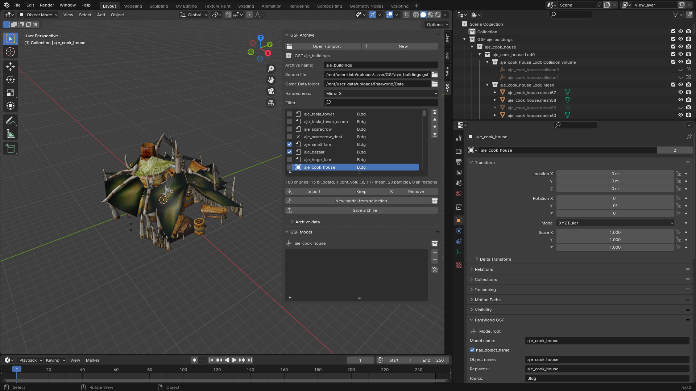

*The screenshots were taken in Blender 4.0 with the add-on's sample data. The add-on needs Blender 4.2 or newer; the
panels look the same there.*

**Contents**

1. [Install](#1-install)
2. [Open an archive](#2-open-an-archive)
3. [The archive panel: choose what to edit](#3-the-archive-panel-choose-what-to-edit)
4. [How a model looks in Blender](#4-how-a-model-looks-in-blender)
5. [Editing values](#5-editing-values)
6. [Animations](#6-animations)
7. [Archive-wide data: sounds, dust trails, groups, walk transitions](#7-archive-wide-data)
8. [Adding a new model](#8-adding-a-new-model)
9. [Saving](#9-saving)
10. [Common tasks, step by step](#10-common-tasks-step-by-step)
11. [Troubleshooting](#11-troubleshooting)

---

## 1. Install

1. Build the zip from the repository (or take `blender/dist/io_scene_paraworld_gsf.zip` if it is already there):

       python blender/make_zip.py

2. In Blender: **Edit > Preferences > Add-ons**. In Blender 4.2 and newer open the drop-down arrow at the top right
   and choose **Install from Disk…**; pick `io_scene_paraworld_gsf.zip`.
3. Tick **Import-Export: ParaWorld GSF format**.

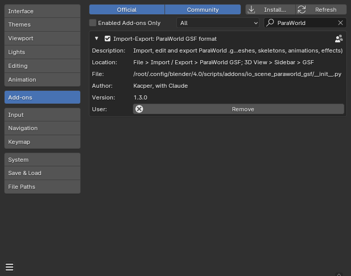

To update, install the new zip the same way and restart Blender.

## 2. Open an archive

Use **File > Import > ParaWorld GSF (.gsf)**, or **Open / Import** in the GSF tab of the 3D view's sidebar (press
**N** in the 3D view to show the sidebar).

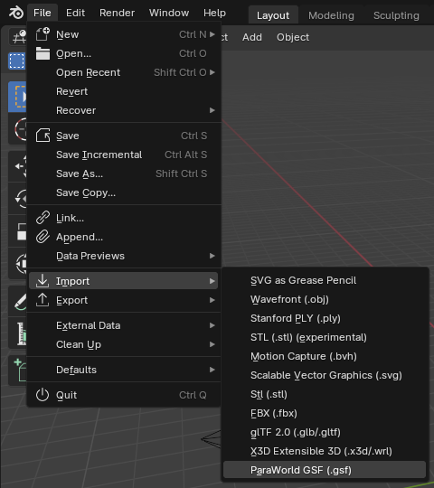

The file browser shows the import options on the right:

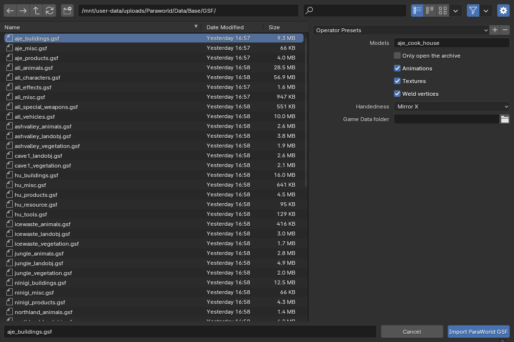

| Option | What it does |
|---|---|
| **Models** | Names of the models to import, comma separated. Patterns work: `seas_*`, `*_dest`. Empty = every model. |
| **Only open the archive** | Read the archive and list its models, but import none. Use this for big archives; pick models afterwards. |
| **Animations** | Import the models' animations as actions. Untick for a quick look at a character archive. |
| **Textures** | Look for the game's textures and show them on the materials. |
| **Weld vertices** | Join vertices that the file stores twice (same position, normal, UV and weights). Cloth is never welded. |
| **Handedness** | The game is left-handed. *Mirror X* (default) flips the x axis, as the ParaWorld Toolkit's glTF files do. Saving mirrors it back. |
| **Game Data folder** | The game's `Data` folder, used to find textures. Left empty, it is guessed from the archive's path (`…/Data/Base/GSF/x.gsf` → `…/Data`). |

Tip: whole character archives (`all_characters.gsf`) hold thousands of animations. Import only the models you need.

## 3. The archive panel: choose what to edit

Every archive you open becomes a collection named `GSF <archive name>`. The **GSF Archive** panel (sidebar, tab
**GSF**) shows the archive of the active object.

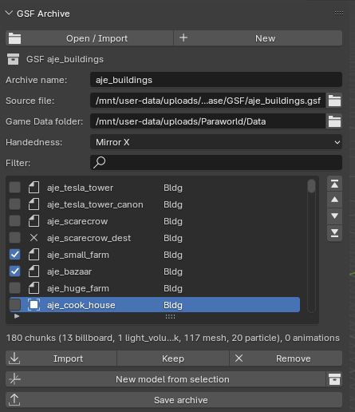

- **Archive name, Source file**: the name written into the file, and the original archive. Models you do not touch
  are copied from the source file when you save, so keep it where it is.
- **Game Data folder, Handedness**: as in the import options.
- **Filter**: shows only models whose name contains the text.
- **New model from selection** and the collection button beside it: see [section 8](#8-adding-a-new-model) and
  [section 4](#4-how-a-model-looks-in-blender).
- **Save archive**: see [section 9](#9-saving).

**The model list.** The icon in front of each model shows what happens to it on save:

| Icon | State | On save |
|---|---|---|
| page | **Keep** | copied unchanged from the source file |
| filled square | **Edited** | written from the objects in the scene |
| **×** | **Remove** | left out |

The line under the list describes the active model: number of chunks by kind and number of animations.

- **Tick boxes + Import**: tick models and press **Import** to bring them into the scene. They become *Edited*.
- **Keep / Remove**: set the ticked models (or the active one) to *Keep* or *Remove*. *Keep* also undoes an import:
  the model is written from the file again and its objects in the scene are ignored.
- **Arrows** beside the list move the active model up, down, to the top or to the bottom. Once you move a model, the
  archive is saved in the list's order (the panel says *Saved in the order of the list*). With a filter, the arrows
  step over hidden models.

## 4. How a model looks in Blender

Each imported model gets its own collection. Inside it:

- the **root empty**, named like the model. It holds the model's own data (name, class, bounding box, material list,
  animations, walk sets). Every other object of the model is parented below it.
- one object per chunk, sorted into **LOD collections** and, inside them, **kind collections**.

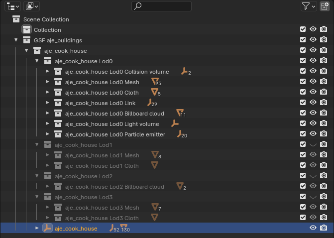

| GSF chunk | Blender object |
|---|---|
| mesh, cloth | mesh object; one material slot per submesh; vertex groups = bone weights |
| skeleton | armature |
| link (attachment point) | empty (arrows); parented to a bone when it hangs on one |
| particle emitter, speed line | empty |
| light volume, cloth collider, collision volume | empty: location = centre, scale = radii / half size |
| billboard cloud | mesh made of points, one per sprite |
| light | point light |

**LOD collections.** A component is put in the collection of the best LOD it is shown on: a mesh with LOD bits 2
and 3 goes to *Lod2*. Components with no LOD bit go to *No LOD*. Hide a LOD collection (eye icon) to look at one level
of detail at a time; in the screenshot Lod1–Lod3 are hidden.

The collections only organise the outliner. What the game shows is decided by each component's LOD bits ([section
5](#5-editing-values)); moving an object to another collection does not change them. After editing LOD bits, press
the collection button beside the model name in the *GSF Model* panel (or the one beside *New model from selection*
for every model of the archive) to sort again.

**Buildings and other states.** A building's chunks include every construction stage, destroyed state, night
lighting and so on; they overlap when all are shown. Their visibility bits (*Con 0–4*, *Dest 1–2*, *Night*, *Age
1–5* …) say when the game shows each one. For the overview screenshot, everything except the finished building was
hidden.

## 5. Editing values

Every value of the file has a field in Blender. Values whose purpose is not known are named `unk_…`; they are
editable like the rest.

### The model (root empty)

Select the root empty and open **Object properties > ParaWorld GSF**.

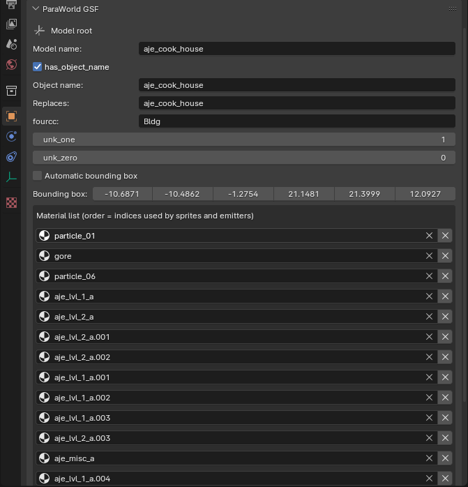

- **Model name**: the name scripts and maps use. **Object name**: the name stored in the model info (usually the
  same). **Replaces**: the model of the source archive this one overwrites on save; change *Model name* and keep
  *Replaces* to save a renamed copy in place of the original.
- **fourcc**: the model class (`Bldg`, `Char`, `Anim`, `Vehi`, `Deko` …). It also decides the names of the
  attribute bits.
- **Bounding box**: untick *Automatic bounding box* to type it in; ticked, it is computed on save.
- **Material list**: the materials sprites and emitters refer to by position. **X** removes one, *Add material*
  adds one.
- **Walk sets** (characters and animals): which animation the game plays for each movement. Each slot picks one of
  the model's animations by name. *Add walk set* / **X** add and remove whole sets.

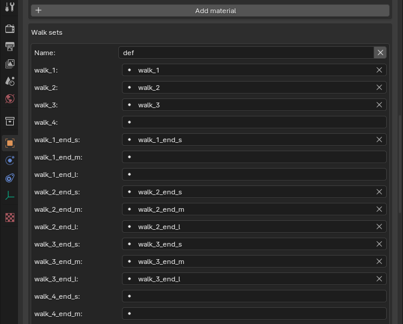

### Components (meshes, links, emitters …)

Select the object and open **Object properties > ParaWorld GSF**.

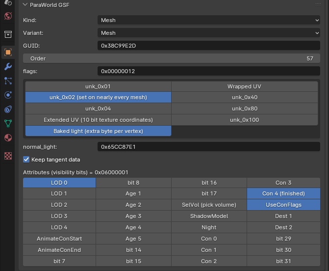

- **Kind**: what the object becomes in the file. *Not part of a GSF model* = ignored on save.
- **Variant**: the chunk type: static or skinned (and cloth for meshes).
- **GUID**: CRC of the component name. Empty = computed from the object's name.
- **Order**: position in the chunk table (only the order within a kind matters).
- The chunk's own fields follow (here `flags` with a button per known bit, and `normal_light`).
- **Attributes**: 32 visibility bits, named after the model's class. **LOD 0–4** are the levels of detail; the others
  depend on the class (construction stages and destroyed states for buildings, armour, saddle and wounds for
  animals …). Click a bit to toggle it.

Particle emitters also show their texture tiles and every particle parameter in file order:

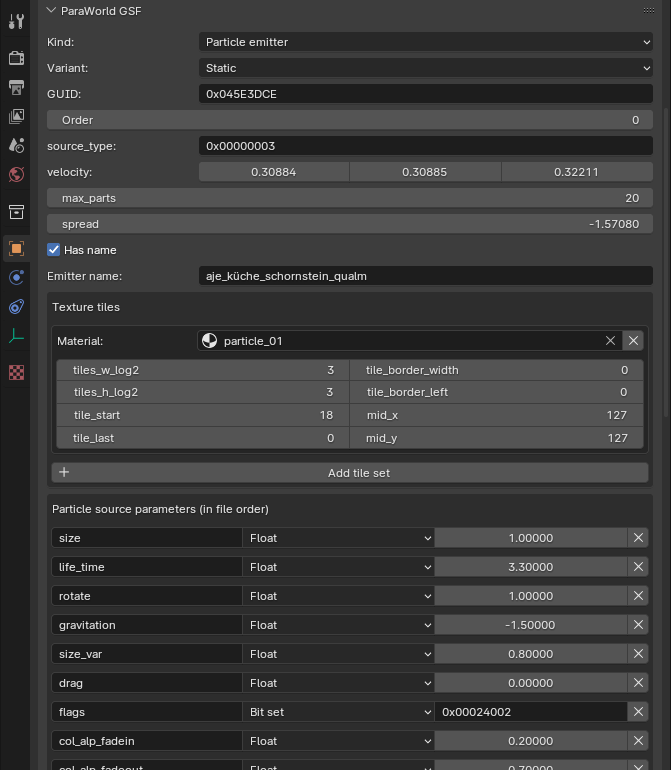

Each tile set and parameter row has an **X**; *Add tile set* and *Add parameter* add new ones. Parameters are stored
by position, so removing one in the middle shifts the meaning of the ones after it.

### Materials

**Material properties > ParaWorld GSF** holds what the game reads: texture paths (below the game's `Texture`
folder), the two attribute words with a button per known bit, and the unknown field.

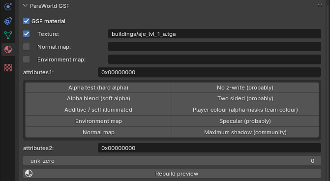

After changing the texture or the alpha bits, **Rebuild preview** updates the material's look in Blender. (The game
does not use Blender's shader nodes; only the fields of this panel are saved.)

### Bones

**Bone properties > ParaWorld GSF**: the bone's GUID (bones are stored as CRCs of their names; imported bones are
called `b_<CRC>` unless the name is known), flags, rest scale and order.

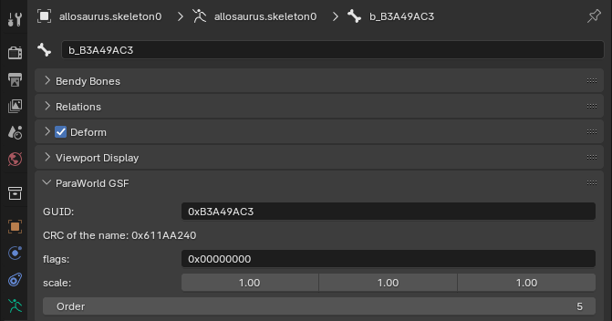

### Geometry

Edit meshes as usual in Edit Mode. On save:

- Normals of meshes you did not edit are written exactly as they were read. Edited and new meshes get normals
  computed the way the game's exporter did, from Blender's smooth/sharp edges. See the export option
  [Normals](#9-saving).
- UVs, vertex groups (bone weights) and the `gsf_baked_light` colour attribute are written.
- Modifiers are applied (option *Apply modifiers*).

## 6. Animations

Select any object of a model. The **GSF Model** panel lists the model's animations.

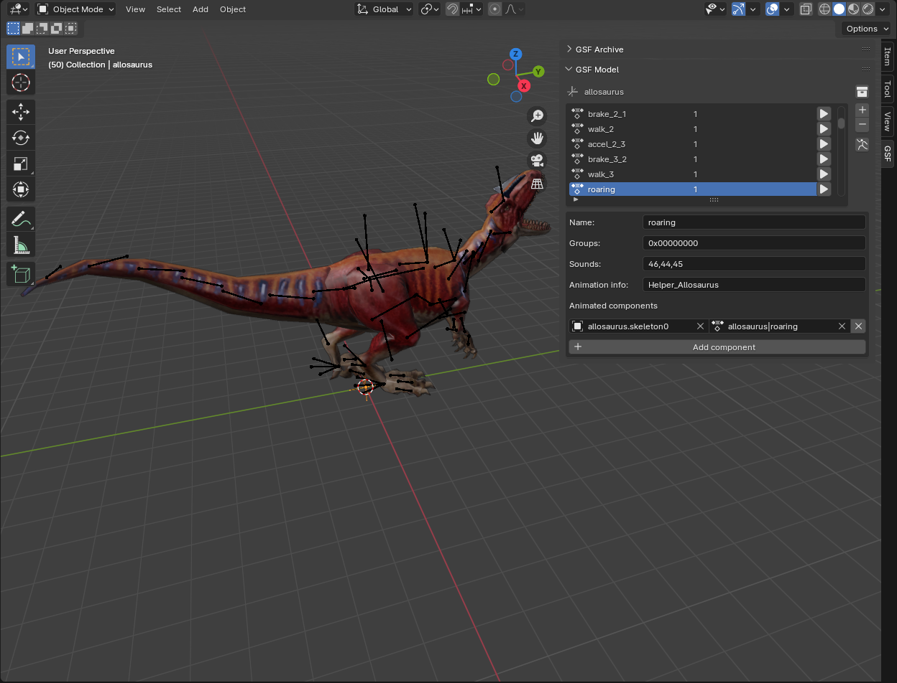

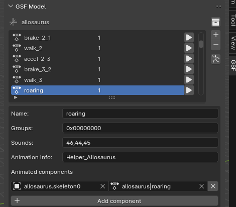

- **▶** on a row plays that animation: it assigns its actions to the model's objects and sets the scene's frame
  range. Press Play in the timeline or scrub.
- The **armature button** (under + / −) goes back to the rest pose.
- **+** makes a new animation from the actions the model's objects have right now (give it a name in the dialog).
  **−** removes the active animation; walk set slots that used it are cleared.
- Below the list: the animation's **Name** (the name scripts use), **Groups** (bit k = animation group k, see
  [section 7](#7-archive-wide-data)), **Sounds** (positions in the archive's sound list, comma separated), the
  **Animation info** name, and the **Animated components**: which object plays which action. **X** removes a row,
  *Add component* adds one.

Edit an animation like any Blender action: change keys in the Dope Sheet or Graph Editor. On save, an animation
whose actions you did not touch is copied from the file exactly; an edited one is rebuilt from its F-curves, sampled
at every whole frame. Constraints and IK are not evaluated, so bake the action first if you use them.

### The action's own data

With an animated object active, the **GSF Action** panel (sidebar) shows the data of its current action:

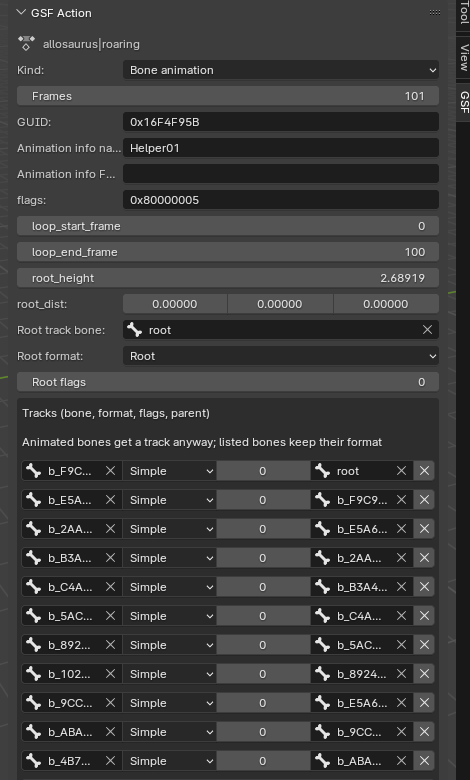

- **Kind** of animation, number of **Frames**, **GUID**, the loop frames and the other stored fields.
- For bone animations: the **root track** bone and format, and the **Tracks** list: each bone's storage format
  (*Simple* tracks can only rotate, *Trans* tracks can also move along the bone) and its parent in the track tree.
  Bones you animate get a track anyway; listing a bone keeps its format. **X** / *Add track* edit the list.
- For mesh and billboard animations: the **frame meshes** (the custom property `gsf_mesh_frame` or `gsf_cloud_frame`
  picks one per frame) and the animation's own material list.

## 7. Archive-wide data

Open **Archive data** below the *GSF Archive* panel. It holds what all models of the archive share.

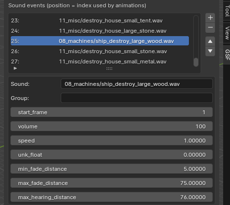

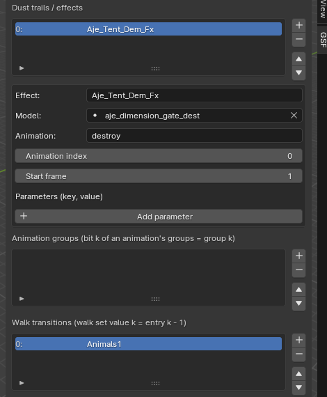

- **Sound events**: the sounds animations play, with volume, fade and hearing distances. Animations refer to them by
  position (the number in front).
- **Dust trails / effects**: effects started at a frame of a model's animation (`CLevelUpFX`, `_dusttrail` …), with
  key/value parameters below.
- **Animation groups**: `idle`, `walk`, `fight`, `work` in character archives. An animation's *Groups* bit k means
  it belongs to group k.
- **Walk transitions**: walk sets refer to them by number (1 = the first entry, 0 = none).

Each list has **+ / − / ▲ / ▼**. Because animations and walk sets refer to these entries by position, removing or
moving an entry renumbers those references for you, so they keep pointing at the same sound, group or transition.
References to a removed entry are dropped. Models marked *Keep* get the same renumbering when the archive is saved.

## 8. Adding a new model

1. Build the model: meshes (with materials), optionally an armature (meshes parented to it with vertex groups named
   like its bones), empties for attachment points and effects.
2. Select all its objects and press **New model from selection** in the *GSF Archive* panel. Name it and choose its
   class.

   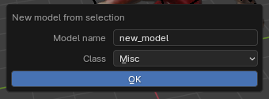

   This makes a root empty, parents the objects to it and guesses each object's kind (mesh, armature → skeleton,
   empty → link, light). New components get LOD bits 0–4 (shown on every level of detail).
3. Fix what the guess cannot know in each object's *ParaWorld GSF* properties: the kind of empties (emitter,
   collision volume …), link names, LOD and other attribute bits, material settings.
4. Add animations with **+** in the *GSF Model* panel (after giving the objects their actions) and walk sets on the
   root.
5. Save.

To start an archive from nothing, press **New** at the top of the *GSF Archive* panel first.

## 9. Saving

Press **Save archive** in the *GSF Archive* panel, or **File > Export > ParaWorld GSF (.gsf)**.

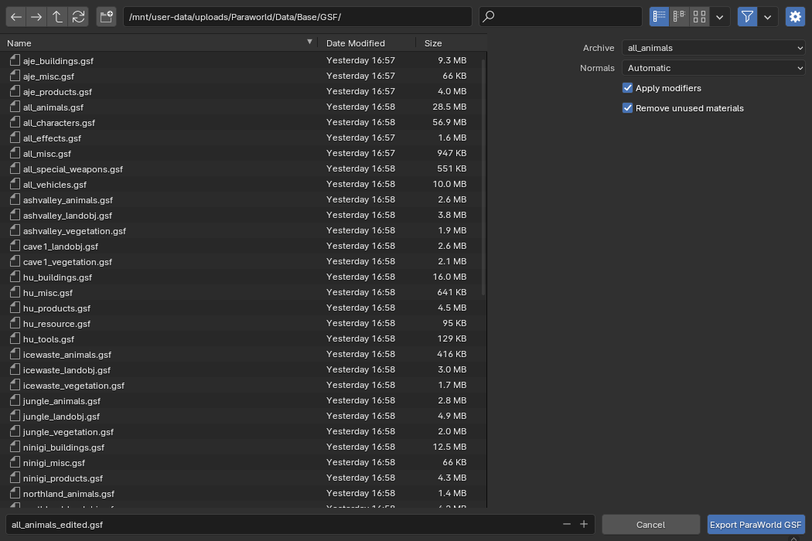

| Option | What it does |
|---|---|
| **Archive** | Which open archive to save. |
| **Normals** | *Automatic* (default): meshes not edited since the import keep the file's normals; edited and new meshes are computed like the game. *Like the game*: always compute. *Keep custom normals*: use Blender's normals as they are, mapped to the game's normal table. |
| **Apply modifiers** | Save meshes with their modifiers applied. |
| **Remove unused materials** | Drop materials no model uses any more from the archive's material table. |

Save under a new name and keep the game's original archives. The game reads archives from `Data/<mod>/GSF`. Any
warnings (for example a mesh vertex without bone weights) are shown in Blender's status bar and in the Info editor.

## 10. Common tasks, step by step

**Change one model of a big archive**

1. Import with *Only open the archive* ticked.
2. In the model list, tick the model and press **Import**.
3. Edit it. Everything else stays *Keep* and is copied from the file.
4. **Save archive** to a new file.

**Hide a part on a level of detail**

1. Select the component; in *Object properties > ParaWorld GSF* toggle its **LOD** bits.
2. Press the collection button in the *GSF Model* panel to re-sort the outliner.

**Remove models from an archive**

1. Tick them in the list (or make one active) and press **Remove**.
2. Save.

**Copy a model under a new name**

1. Import it, change *Model name* on the root and clear *Replaces*.
2. Save. The original is written as it is in the file, and the copy is added after it.

**Give an animal a new animation**

1. Import the animal. Select its armature, create a new action and key the bones.
2. Select the root and press **+** in the *GSF Model* panel; name the animation.
3. Optionally put it in a walk set slot on the root, or in an animation group via *Groups*.
4. Save.

**Add a sound to an animation**

1. In *Archive data*, select the entry after which the new sound should go and press **+**. Fill in *Sound* (path
   below the game's `Audio` folder) and its values.
2. In the animation's *Sounds* field, add the number of the new entry.

## 11. Troubleshooting

| Problem | What to do |
|---|---|
| Models are grey or pink | Textures were not found. Set **Game Data folder** in the *GSF Archive* panel to the game's `Data` folder, then press **Rebuild preview** on the materials. The textures are only a preview; the saved file stores the texture paths. |
| Everything overlaps (buildings) | All construction stages, destroyed states and LODs are shown together. Hide LOD collections, or hide components by their attribute bits. See [section 4](#4-how-a-model-looks-in-blender). |
| "source archive is missing" on save | Models marked *Keep* are copied from the *Source file*. Point it to the original archive again. |
| A model is "marked Edited but its root object is gone" | Its root empty was deleted. It is saved from the file instead. Import it again to edit it. |
| An edited animation looks different in the game | Bake constraints and IK into keys first. Check the *Tracks* list in the *GSF Action* panel: a *Simple* track cannot move a bone. |
| An animation of a model shares data with others | Unchanged animations stay shared between models in the file. Once you edit one, the edited model gets its own copy. |
| The archive is slow to import | Import only the models you need (*Only open the archive*, then tick and **Import**), or untick *Animations*. |
