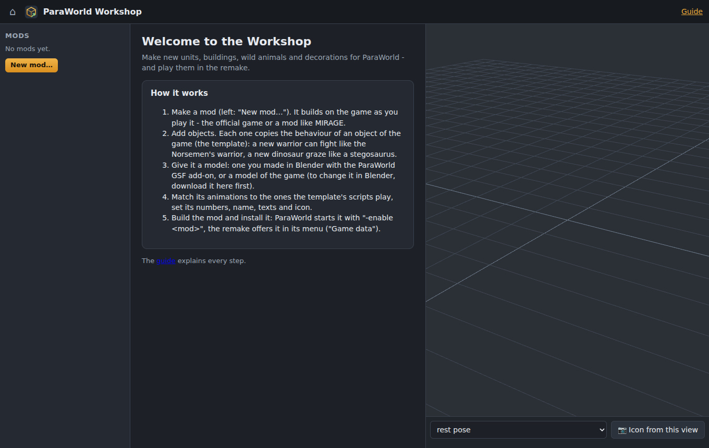
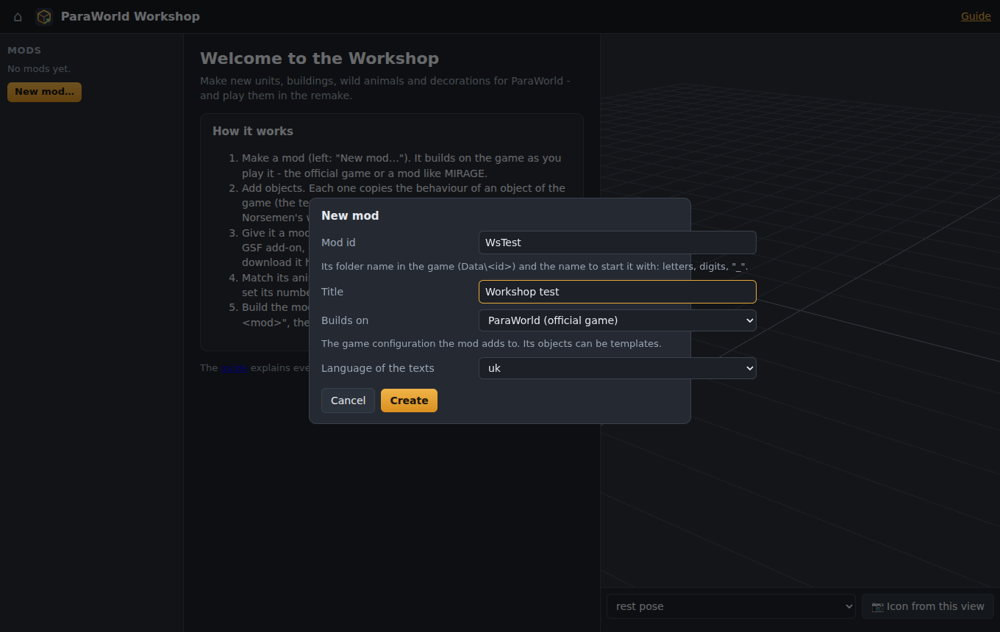
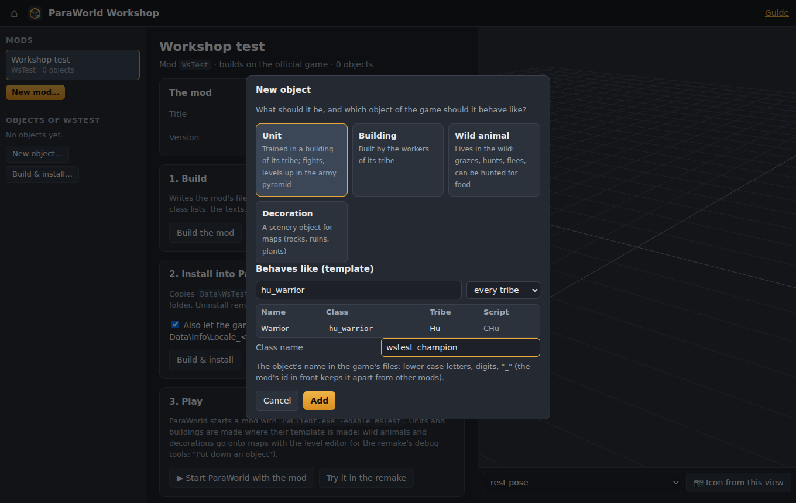
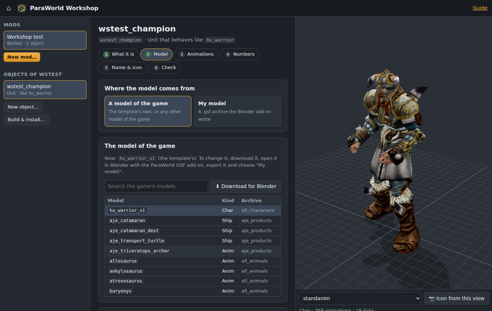
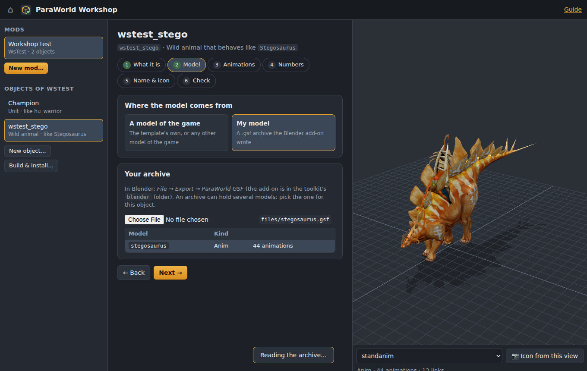
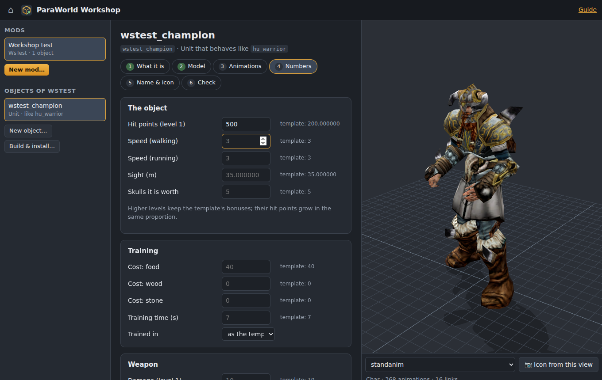
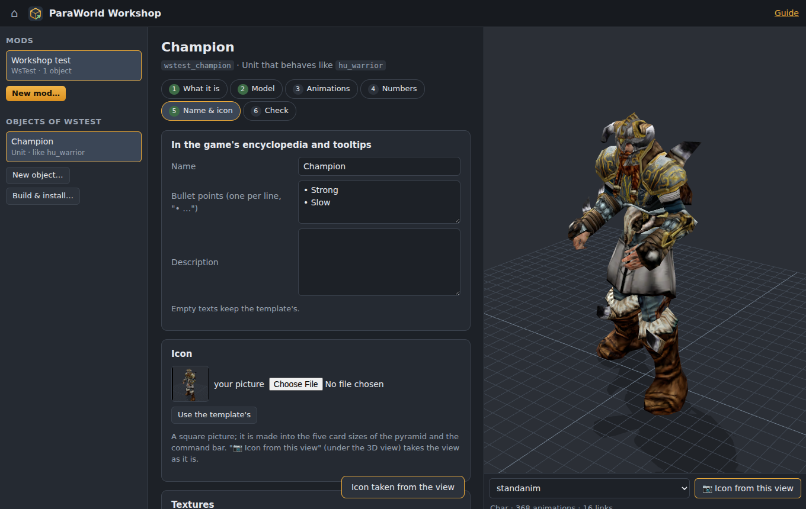
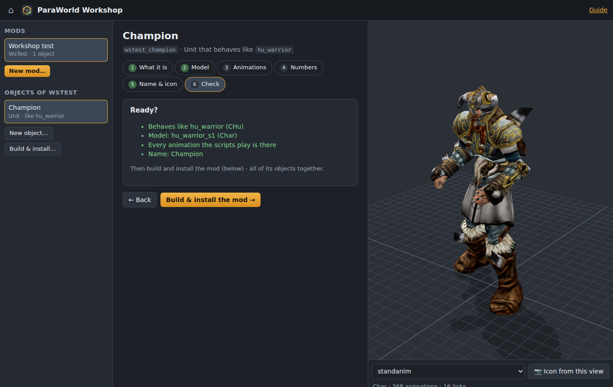
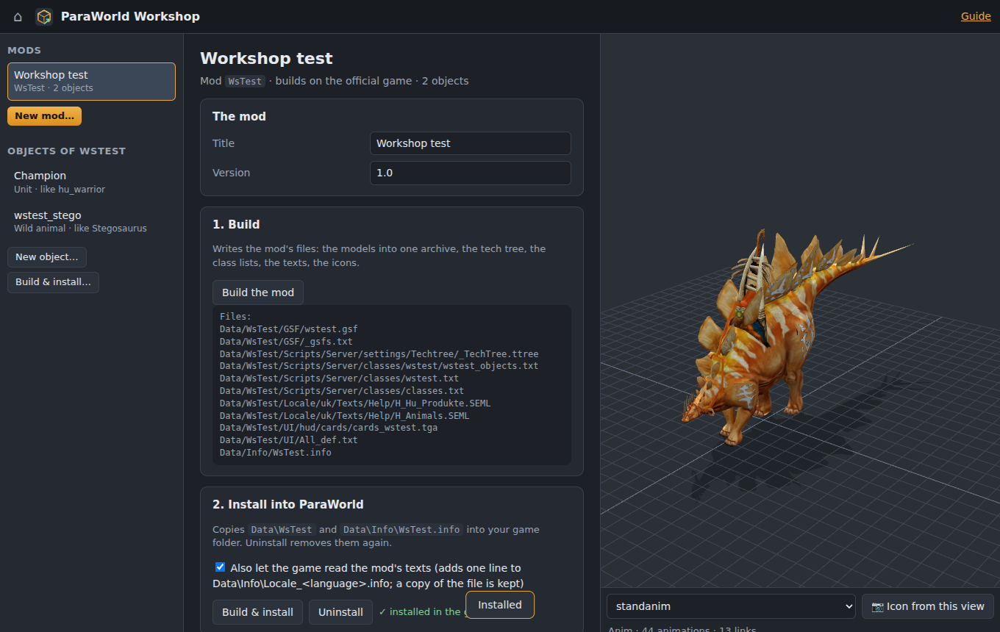
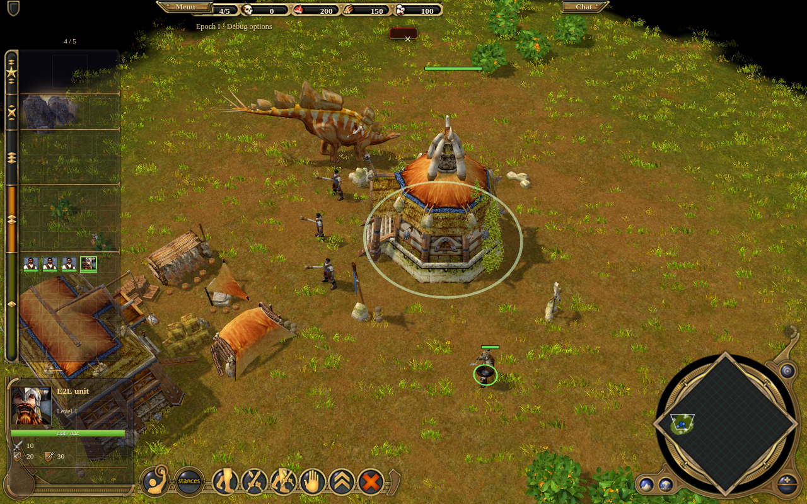

# ParaWorld Workshop

The Workshop puts new objects into ParaWorld: **units, buildings, wild animals and decorations**. You bring a 3D
model (made in Blender with the ParaWorld GSF add-on, or one of the game's models to change), the Workshop walks you
through the rest, and at the end you have a **mod** that the original game loads and that the **remake** plays too.

You do not need to know the game's files. Everything the game needs - the tech tree entries, the class lists, the
model archive, the texts, the icons - the Workshop writes for you.

Open it from the toolkit's start page (**Workshop → Open**), or go to `http://127.0.0.1:8420/workshop/` while the
toolkit runs.

- [Quick start](#quick-start)
- [The ideas behind it](#the-ideas-behind-it)
- [Step by step](#step-by-step)
- [Making the model in Blender](#making-the-model-in-blender)
- [Playing the mod](#playing-the-mod)
- [What the mod contains](#what-the-mod-contains)
- [Limits](#limits)
- [Troubleshooting](#troubleshooting)
- [For developers](#for-developers)

## Quick start

1. **New mod…** (left). Give it an id such as `MyCreatures` - it becomes the folder `Data\MyCreatures` in the game -
   and choose what it builds on: the official game, or a mod such as MIRAGE.
2. **New object…**. Choose the kind (unit, building, wild animal, decoration) and the object of the game it should
   behave like - the *template*. Give it a class name such as `mycreatures_champion`.
3. **Model**: keep the template's model, pick another model of the game, or upload your own `.gsf`.
4. **Animations**, **Numbers**, **Name & icon**: match the animations, set hit points, costs, damage, write its name
   and description, take an icon.
5. **Build & install…** → **Build & install**. Start ParaWorld with the mod, or **Try it in the remake**.



## The ideas behind it

**A mod.** ParaWorld loads extra data folders that are described by a file in `Data\Info`: the official Booster Pack
and MIRAGE are mods in this sense. A Workshop project is one such mod. It *builds on* a game configuration - the
official game (Base + Booster Pack 1) or another mod - and adds its objects to it. When ParaWorld starts the mod, it
loads the configuration it builds on first.

**A template.** The game's behaviour is in scripts - how a warrior fights, how a stegosaurus grazes and flees, what a
warehouse stores. The Workshop does not write new scripts: every new object copies the behaviour of an object of the
game, its *template*. With the behaviour come its rules: hit points, speed, weapons, costs, where it is made, its
level-ups and upgrades, its help text and icon. You then change what should be different: the model, the name, the
numbers.

| Kind | Templates | What the new object gets from its template |
|---|---|---|
| Unit | units of the four tribes that a building trains (characters, riding animals, vehicles, ships) | script, weapons (copied as its own), level-ups, upgrades, the build button in the same building, moves |
| Building | buildings of the four tribes that workers build | script, the build button, upgrades offered in it, storage / housing |
| Wild animal | the animals of the world (`World/ANML`) | script (grazing, hunting, fleeing), weapons, the carcass it leaves for food (`<name>_food`) |
| Decoration | scenery objects (`CDecoObj`, `CDecoColObj`, `CDecoColAnimObj`) | whether it blocks units, its animation loop |

**A class name.** Every object of the game has one (`hu_warrior`, `Stegosaurus`). The new object's class name is
also the name of its model in the mod's archive and of its icon. Put the mod's id in front (`mycreatures_...`) so two
mods never pick the same name.

## Step by step

### 1. A new mod



| Field | Meaning |
|---|---|
| Mod id | the folder `Data\<id>` and the name ParaWorld starts the mod with (`-enable <id>`). Letters, digits, `_`. |
| Title | shown in the remake's menu and written into the mod's description |
| Builds on | the game configuration the mod adds to. The objects of that configuration are the templates: build on MIRAGE to use MIRAGE's units as templates. |
| Language of the texts | the language of the names and descriptions you write (they are written into that language's text folder) |

The projects are kept in the toolkit's folder (`%APPDATA%\ParaWorldToolkit\workshop\<id>`): `project.json` and the
files you uploaded.

### 2. A new object



Pick the kind, then the template in the list (search by name or class; units and buildings can be filtered by tribe).
The list shows each object's name in the game, its class, its tribe and its script class.

### 3. What it is

The first step shows the kind and template again; you can change them here later. Changing the template keeps your
model, numbers and texts, but the animation matching starts over. **Remove this object** takes it out of the mod.

### 4. Model



- **A model of the game**: the template's own model, or any other model of the configuration (the list shows the
  chosen one first, then the models of the same kind). Good for a variant with other numbers, or as a starting point:
  **⬇ Download for Blender** gives you that model as an archive of its own, to open in Blender.
- **My model**: upload a `.gsf` archive written by the Blender add-on. An archive can hold several models; pick the one
  for this object. The list warns when the model's kind (`Char`, `Anim`, `Bldg` ...) is unusual for the object.



The 3D view on the right shows the model as the game draws it, with its animations (the list under it).
For units of the Norsemen and others whose model changes with the level (`hu_warrior_s1` … `s5`), tick **Keep the
template's own models for levels 2-5** to change only level 1; otherwise every level shows your model.

### 5. Animations


The game plays animations by name: `walk_1`, `standanim`, `attack_front`, `die_front` … The table lists every name the
template's model has - those are the names its scripts can ask for. For each one your model lacks, choose one of its
own animations to play instead (▶ shows it). A model animation chosen for a name is stored under that name in the mod's
archive; one chosen for several names is stored under each. Names left empty are not played: the object simply keeps
its pose for that moment.

Below, the **links** of the template's model: the points where scripts attach weapons, riders, flags and effects. If
your model lacks one the object should use, add a link of that name in Blender (the add-on's manual: links).

### 6. Numbers



Every field shows the template's value; an empty field keeps it.

| Field | Where it goes |
|---|---|
| Hit points | the object's level 1. The levels above keep the template's bonuses, scaled in the same proportion |
| Speed (walking / running), sight, skulls | the object's tech tree entry |
| Cost, training / construction time | the build actions (the template's actions for each level are copied) |
| Trained in | another building of the template's build locations |
| Damage, range, attacks per minute | the weapon of level 1; the weapons of the higher levels keep their ratio to it |

### 7. Name & icon



- **Name**, **bullet points**, **description**: the tooltip and the encyclopedia entry. Empty texts keep the
  template's. One bullet per line.
- **Icon**: the template's icon, your own picture (square; it is made into the five card sizes), or **📷 Icon from this
  view**: turn the model in the 3D view, then take it.
- **Textures**: the pictures your model's materials name. A texture the game does not have (one you painted) shows as
  *missing*: give a PNG / JPG / TGA picture and the Workshop writes it as the game's DXT5 `.dds` with its mipmaps, under
  the name the material asks for, and adds it to the texture detail table. A picture for a texture the game has
  replaces it for this mod.

### 8. Check



A summary: template, model, model kind, missing animations, name, and anything that would stop the build.

### 9. Build and install



**Build & install…** (left) opens the mod's page.

1. **Build the mod** writes the mod's files into the project's `build` folder and lists them, with warnings (a
   texture neither the game nor you have, a template without a build action ...). **Download as zip** packs them to
   share: unpack the zip into the ParaWorld folder.
2. **Build & install** copies `Data\<id>` and `Data\Info\<id>.info` into your game. With the box ticked it also lets the
   game read the mod's texts: ParaWorld only reads the text folders its language packs list, so the Workshop adds one
   line to `Data\Info\Locale_<language>.info` (it keeps a copy of the file as `….workshop-backup` the first time, as
   MIRAGE's installer does). **Uninstall** removes the folder, the description and that line.

## Playing the mod

**ParaWorld.** Start the game with `bin\PWClient.exe -enable <id>` - **▶ Start ParaWorld with the mod** does that. A
shortcut with that line works too. The mod loads the configuration it builds on (for example MIRAGE) by itself.

- A new **unit** is trained where its template is: its button sits in the same building, on a free place of the same
  menu page (the levels of a unit share one button, as in the game).
- A new **building** is in the workers' build menu, next to its template.
- **Wild animals** and **decorations** are not in any menu: put them onto a map with the game's level editor.

**The remake.** An installed mod is a game configuration like MIRAGE: the remake's campaign menu offers it under
**Game data**, and the launcher prepares its data the first time (several minutes). **Try it in the remake** on the
mod's page prepares the data and then opens a skirmish with your objects standing next to your start (with the debug
option *everything free and instant*, so you can train and build them at once). In any game with debug options, the
pause menu's **Debug tools → Put down an object** places any object - also wild animals - at the middle of the screen.



## Making the model in Blender

The ParaWorld GSF add-on is in the toolkit's `blender` folder (`blender/README.md`, `blender/docs/MANUAL.md`).

1. Start from a model of the game: **⬇ Download for Blender** in the Model step, then in Blender
   *File → Import → ParaWorld GSF*. The skeleton, the animations, the links and the materials come with it - change
   the mesh, paint the texture, keep what the game needs.
2. Or build a new one. Then check:
   - **Kind** (the model's four-character code in the add-on's model properties): `Char` for characters, `Anim` for
     animals and riding dinosaurs, `Vehi` vehicles, `Ship`, `Bldg` buildings, `Deko` / `Misc` decorations. The kind
     decides what the model's attribute bits mean.
   - **Size**: 1 Blender unit = 1 metre. Compare with the template (the 3D view shows both at the same scale).
   - **Animations** with the template's names (or match them in the Workshop's Animations step).
   - **Links** the scripts use: see the Animations step.
   - **LODs**: set the mesh's LOD bits (attribute bits 0-4, one per distance) - a mesh without them is not drawn at
     every distance. The add-on's LOD collections only sort the outliner; the bits decide.
   - **Collision volumes** for buildings and decorations that block units.
   - **Materials**: the texture names are paths below the game's `Texture` folder (`Animals/my_dino_a.tga`); give
     the pictures in the Name & icon step.
3. *File → Export → ParaWorld GSF*, then upload the archive in the Model step.

Buildings: the game shows a building under construction through its construction states (the parts with state bits
A, B, C) and its damage states. A model without them stands finished from the first moment of the construction.

## What the mod contains

The game replaces whole files, it does not merge them: a file the mod changes is a full copy of the configuration's
file with the mod's additions (as MIRAGE ships its own tech tree).

| File | What it is |
|---|---|
| `Data\Info\<id>.info` | the mod: `id`, `requires` (what it builds on), `type add-on`, `priority`, `tryfilereplace` lines that put the mod's folder over the configuration's folders |
| `Data\<id>\GSF\<id>.gsf` | the models of the mod's objects, each named after its object |
| `Data\<id>\GSF\_gsfs.txt` | the list of archives the game loads, with the mod's one added |
| `Data\<id>\Scripts\Server\settings\Techtree\_TechTree.ttree` | the tech tree with the new objects, their weapons, level bonuses, build actions, and the lists their template is in (moves, inventions) |
| `Data\<id>\Scripts\Server\classes\classes.txt`, `<id>.txt`, `<id>\<id>_objects.txt` | the class lists: each object's script class and model |
| `Data\<id>\Locale\<lang>\Texts\Help\*.seml` | the encyclopedia files with the new entries (name, tooltip, description) |
| `Data\<id>\UI\All_def.txt`, `UI\hud\cards\cards_<id>.tga` | the icon atlas with the new icons |
| `Data\<id>\Texture\...dds`, `Texture\detailtable.txt` | textures you gave, and their entries in the detail table |

The remake reads the same files when it prepares a configuration's data (`remake/docs/DATA_PIPELINE.md`): the rules
from the tech tree, the models from the archive, the icons from `All_def.txt`, the texts from the help files.

## Limits

- **No new behaviour.** An object behaves like its template. New abilities need new scripts, which the Workshop does not
  write.
- **Sounds** come with the template's animation names (a sound plays when the model's animation of that name has it).
  Your own sounds need the add-on's sound list in the archive.
- **Texts in one language** per project (the language of the project); other languages show the class name.
- **Wild animals and decorations** appear in ParaWorld only where a map places them (level editor).
- **Tested** against the game's files: the Workshop's archives, tech tree, class lists, help and icon files are read
  back by the toolkit's own readers and by the remake's data pipeline. The ParaWorld program itself was not run with a
  Workshop mod while it was written - if the game refuses a mod, the [troubleshooting](#troubleshooting) list below
  says where to look, and a report helps.

## Troubleshooting

| What happens | Why, and what to do |
|---|---|
| "the game already has an object of this name" | class names are unique in the whole game: choose another (keep the mod's id in front) |
| The object stands still or slides | its model lacks animations the scripts play: Animations step |
| A weapon or rider floats beside the unit | a link is missing or elsewhere: compare the links with the template's model |
| The model is white / grey | a texture is missing: Name & icon → Textures |
| The button is missing in the building | the template has no build action in that configuration (warning of the build), or the mod is not started (`-enable <id>`) |
| The name shows as `_mycreatures_...` | the game does not read the mod's texts: install with "let the game read the mod's texts" ticked |
| The remake does not offer the mod | it is not installed, or the remake's data of that configuration is not prepared yet (launcher) |

## For developers

The Workshop is the Python package `workshop/` of the toolkit and its page `workshop/web/`.

| Module | Job |
|---|---|
| `gamedata.py` | a configuration's tech tree, class lists, help files, icon atlas, archives; the templates |
| `ttree.py` | ParaWorld's tree text files (tech tree, class lists): read and written back byte for byte |
| `gsfedit.py` | the mod's archive: models copied out of archives with the Blender add-on's core (`blender/io_scene_paraworld_gsf/core`), renamed, animations renamed for the scripts |
| `build.py` | writes the mod (the table above) |
| `dds.py` | DXT5 `.dds` with mipmaps, TGA |
| `install.py` | install, uninstall, zip |
| `project.py` | `project.json` (schema in its docstring) |
| `api.py` | the HTTP API under `/api/workshop/` (list in its docstring) and the page under `/workshop/` |

Command line (no browser):

```
python -m workshop templates <game> [--base MIRAGE] [--kind unit]
python -m workshop build <project folder> <game> <out folder>
python -m workshop install <project folder> <game>      /  uninstall <mod id> <game>
```

Tests: `python workshop/tests/test_build.py <game>` (builds a mod with one object of each kind and reads every file
back), `python workshop/tests/ui_test.py <toolkit url> [screenshots folder] [archive.gsf]` (the page in a browser).
The remake's side: `remake/tests/debug_options.js` (debug options and putting objects down).
