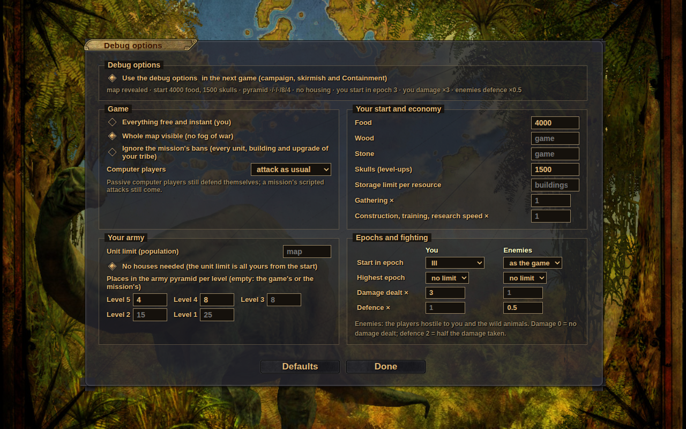
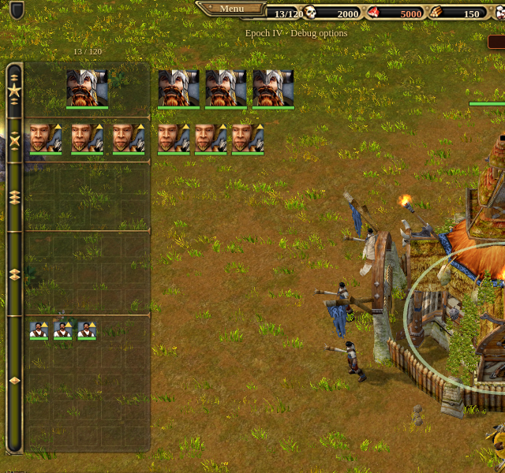
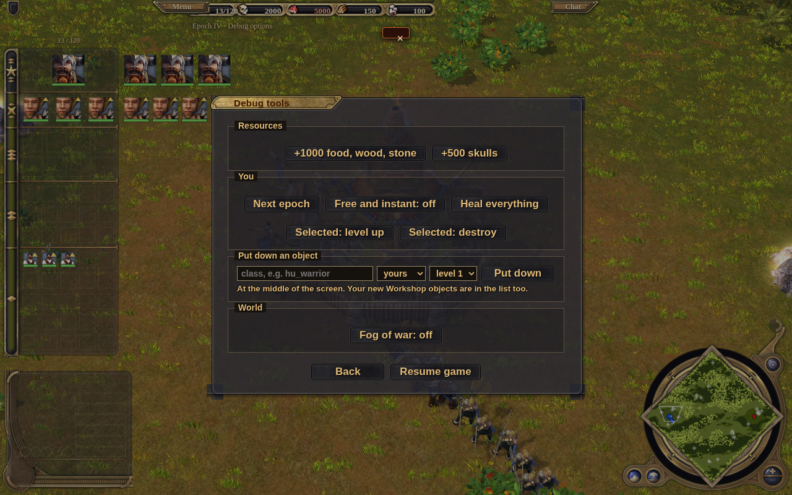

# Debug options

Before a game starts - a campaign mission, a skirmish or a mission of Containment - the menu's **Debug options…**
button opens a page of options that change the rules of the next game: start resources, epochs, the army pyramid,
the unit limit, damage and defence of both sides, the whole map visible, and more. In the game, the pause menu then
has **Debug tools** for things done at once (resources, the next epoch, putting objects down, winning the mission).

They are for trying things out - a mission with a big army, a unit of the Workshop, a late epoch - not for a normal
game. A game with debug options says so on the HUD ("Epoch III · Debug options").

## The options

The page is the same from the campaign, the skirmish and the Containment window. The choices are kept (settings
`cheats`) and apply to the next game while **Use the debug options** is ticked; changing any option ticks it. The
line under the window's buttons says what is on. **Defaults** puts every option back.

| Option | What it does |
|---|---|
| Everything free and instant (you) | buildings stand at once, units are trained and upgrades researched at once, nothing costs anything, level-ups need no skulls (the older "debug mode") |
| Whole map visible | no fog of war: every place explored and seen |
| Ignore the mission's bans | a campaign or Containment mission forbids units, buildings and upgrades (the level's AntiActions, the TECH triggers); with this, nothing is forbidden for you |
| Computer players: do not attack you | the computer players' own attack planning leaves you alone (they still defend themselves; a mission's scripted attacks still come) |
| Food, wood, stone, skulls | your start resources (empty: the game's or the mission's) |
| Storage limit per resource | your storage is at least this big, whatever your buildings hold |
| Gathering × | every load your workers deliver is worth that much more |
| Construction, training, research speed × | your buildings go up and your units and upgrades are done that much faster |
| Unit limit | your population limit (empty: the map's or the mission's, 52 in a skirmish) |
| No houses needed | your unit limit is all yours from the start |
| Places in the army pyramid per level | how many units of each level you may have (empty: 25 / 15 / 8 / 3 / 1, or the mission's) - six units of level 5, for example |
| Start in epoch (you / enemies) | the epoch upgrades are given at the start, as if researched at the headquarters |
| Highest epoch (you / enemies) | the epoch upgrades above it do not exist |
| Damage dealt × (you / enemies) | every hit of that side does that much; 0 = no damage at all |
| Defence × (you / enemies) | that side takes damage ÷ this: 2 = half the damage |

*You* is the human player. *Enemies* are the players hostile to you when the game starts and - for damage - whoever
is hostile at the moment of the hit, and everything without an owner: wild animals, neutral buildings. Allies and
neutral players play by the normal rules.

## The pyramid beside the pyramid

The pyramid's picture has room for 25 / 15 / 8 / 3 / 1 cards. More places on a level draw the extra cards to the right
of the pyramid, on the lines of their row; empty extra places are outlined. They behave like the others: click,
double-click, drag onto another row to level up.

## Debug tools

In a game with debug options, the pause menu (Esc) has **Debug tools**:

| Button | What it does |
|---|---|
| +1000 food, wood, stone / +500 skulls | added at once, above the storage limit too |
| Next epoch | the next epoch upgrade (up to the highest epoch of the options) |
| Free and instant | switches the first option on or off for the rest of the game |
| Heal everything | your units to full health, your buildings repaired |
| Selected: level up / destroy | the selected units one level up (for skulls, unless free); the selection destroyed |
| Put down an object | a unit, an animal or a building of any tribe - yours, an enemy's or wild - at the middle of the screen, at the level chosen. The list has every class of the game's data, also the objects of a [Workshop](../../docs/WORKSHOP.md) mod |
| Fog of war | on or off |
| Win / lose the mission | ends a campaign or Containment mission at once (the next mission opens as after a real win) |

## For tests and links

- `?cheats=<json>` in the page's address starts the game of the address with those options (`?quick`, `?campaign=N`,
  `?sequel=N`): `{"res": {"food": 5000}, "pyramid": [null, null, null, null, 6], "me": {"startEpoch": 3, "dmg": 2},
  "foe": {"def": 0.5}, "ai": "passive"}`. The keys are those of `game/cheats.js`.
- `?spawn=<class>,<class>[&spawnside=me|foe|wild][&spawnlevel=n]` puts those objects next to your start once the game
  runs (their models are loaded with the game). The Workshop's "Try it in the remake" uses it.

## How it works

- `src/game/cheats.js`: the options (`defaultCheats`, `normCheats`, `cheatSummary`), `applyCheats` (called by
  `main.js` once the players and the world exist, before the computer players start), the sides (`sideOf`), the
  damage factor (`cheatDamage`), `raiseEpoch` (completes the age upgrades through `World.completeUpgrade`, so the
  headquarters' look and name follow), `spawnObject`.
- The rules read them where they are decided: `systems/combat.js damage` (every hit passes there), `rules.js check`
  (`owner.maxEpoch` hides the epoch upgrades above it), `systems/economy.js gain` and `recomputeCaps`
  (`player.cheat`: gathering, storage, no housing), `systems/production.js productionTime` and
  `systems/construction.js` (speed), `production.js pyramidFor` (`player.pyramid`), `ai/attack.js requestAttack`
  (passive), `campaign/setup.js` + `scripting.js setFilter` (`player.unlockAll`), `campaign/actions.js` POPL / BLSL
  (a mission's later unit limit or pyramid does not replace the option's).
- The options are part of the game's config (`G.config.cheats`): a saved game and "Restart" keep them; the world keeps
  `W.cheats` (saved with it).
- `ui/debugopts.js` is the page and the summary line; `ui/menu.js debugTools` the pause menu's window; `ui/hud.js
  slotRects` the extra pyramid places.
- Tests: `tests/debug_options.js` (every option, the tools, `?spawn=`), `tests/debug_menu.py` (the page from the
  campaign menu, a mission started with it).
